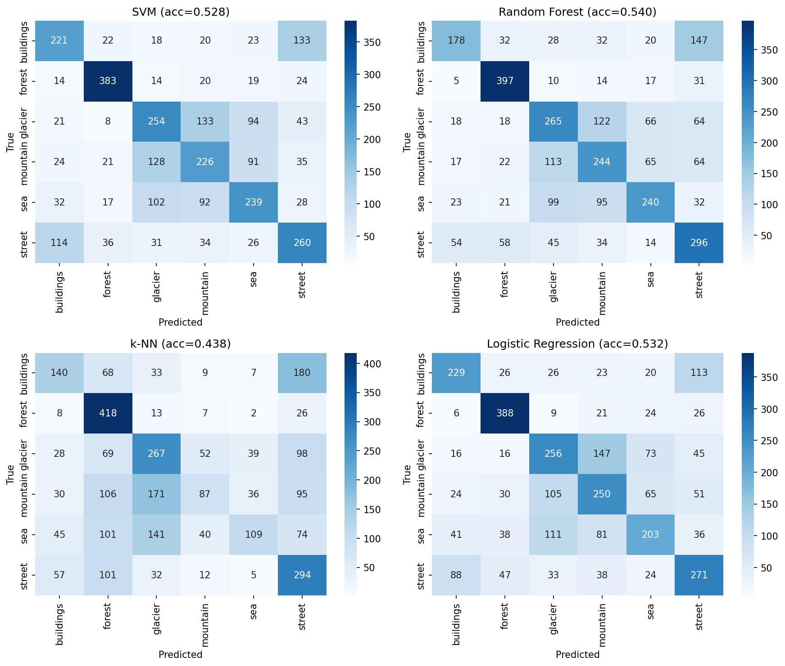
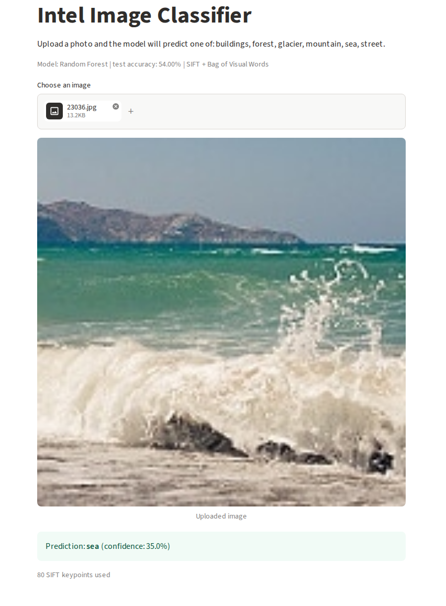

# Intel Image Classification (SIFT + Machine Learning + Streamlit)

## Project overview
An end-to-end image classification system that classifies natural scenes into 6 classes
(buildings, forest, glacier, mountain, sea, street) without deep learning.

Pipeline: load images -> resize to 128x128 + grayscale -> SIFT descriptors ->
Bag of Visual Words (KMeans, 100 words) -> fixed-size vector -> scikit-learn classifiers ->
evaluation -> save best model -> Streamlit app for live prediction.

## Dataset
[Intel Image Classification (Kaggle)](https://www.kaggle.com/datasets/puneet6060/intel-image-classification)
- About 25,000 images (150x150, RGB) in 6 classes, split into `seg_train` and `seg_test`.
- Classes: buildings, forest, glacier, mountain, sea, street.

## Tools used
OpenCV (image loading, SIFT), scikit-learn (KMeans, SVM, Random Forest, k-NN, Logistic Regression),
NumPy / pandas, matplotlib / seaborn, joblib, Streamlit.

## Project structure
```
notebooks/intel_image_classification.ipynb   # full pipeline with outputs
train.py                                     # same pipeline as a script
app.py                                       # Streamlit app
models/best_model.joblib                     # saved best model
results/                                     # plots
screenshots/                                 # app screenshots
requirements.txt
```

## How to run
Training (option 1): open the notebook in Google Colab and run all cells.

Training (option 2): download the dataset from Kaggle, unzip it to `intel_data/`, then run
```
python train.py --data intel_data --out models
```

Inference:
```
pip install -r requirements.txt
streamlit run app.py
```
Upload an image to see the predicted class and confidence score.

## Results
| Model | Test accuracy |
|---|---|
| Random Forest | 54.00% |
| Logistic Regression | 53.23% |
| SVM | 52.77% |
| k-NN | 43.83% |

Best model: **Random Forest** (54.00%)



##Screenshot

